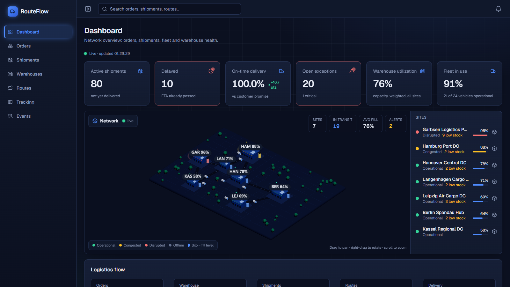
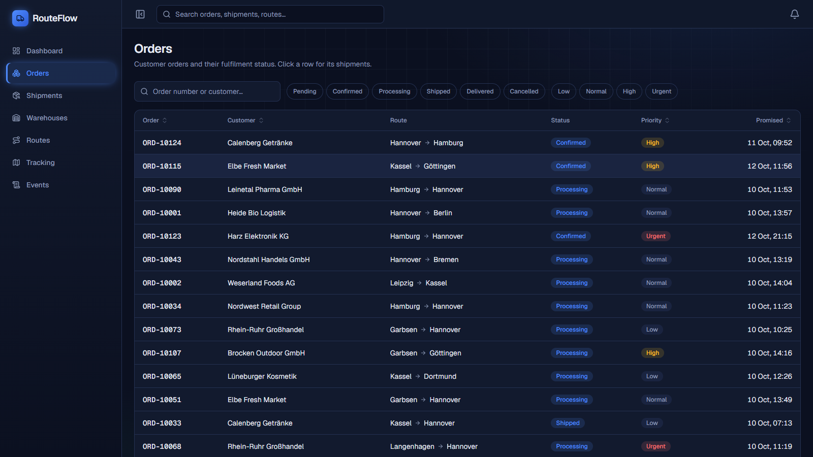
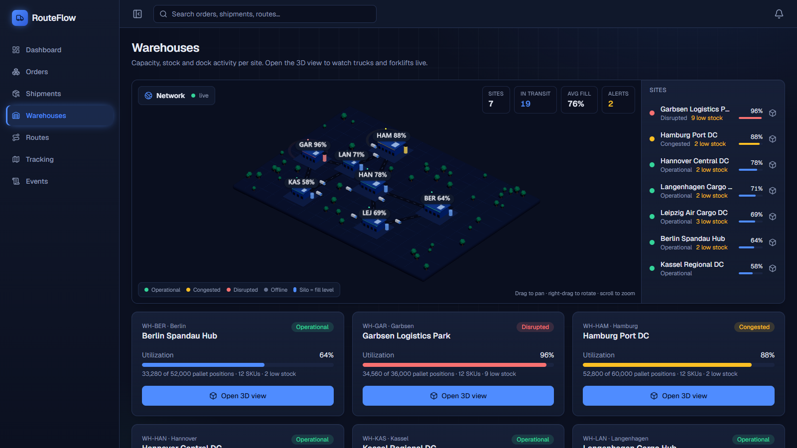
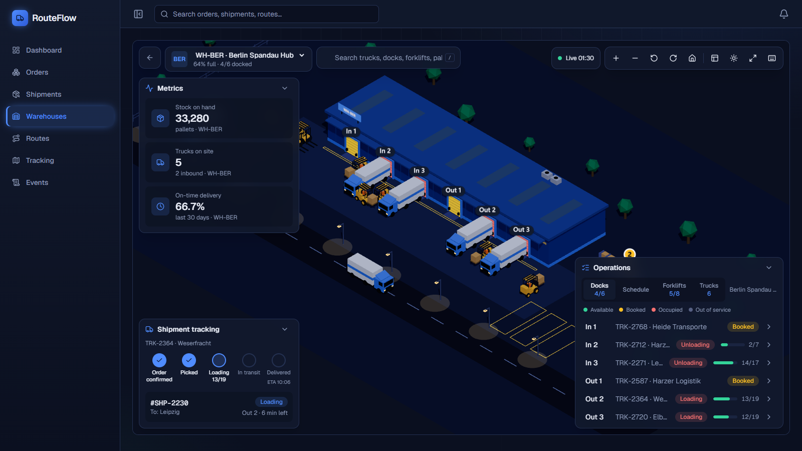
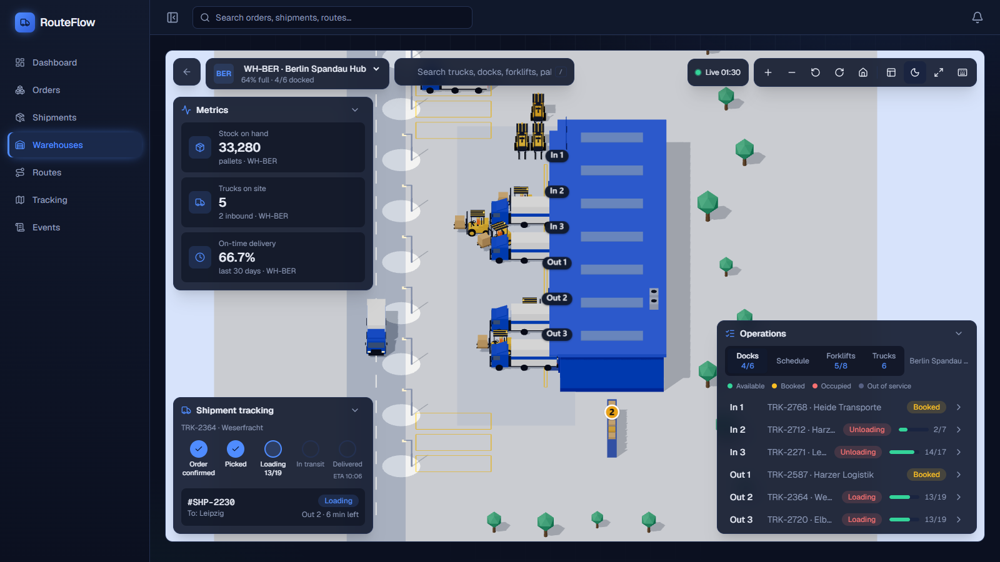
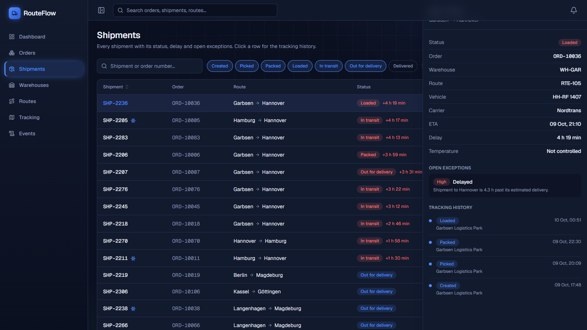
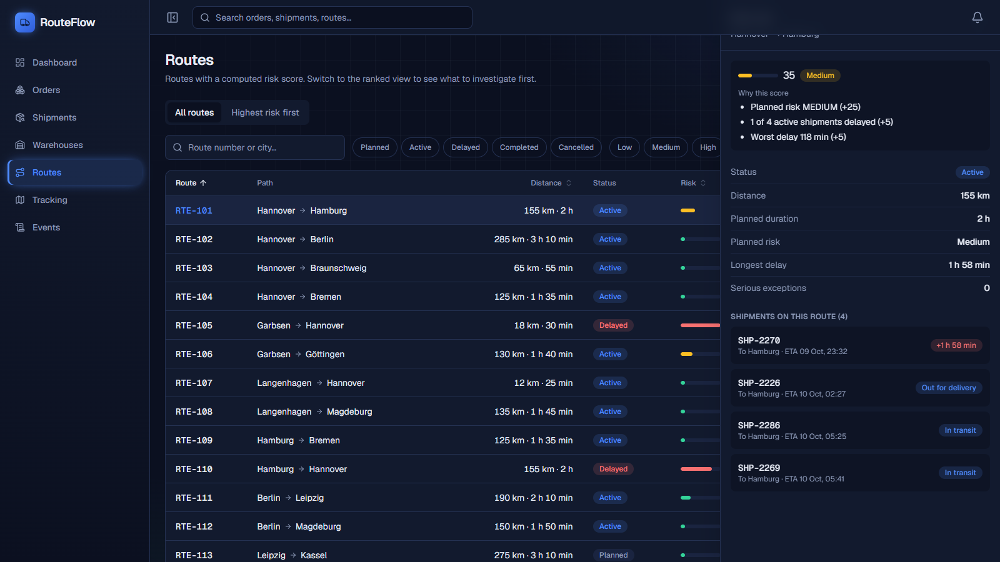
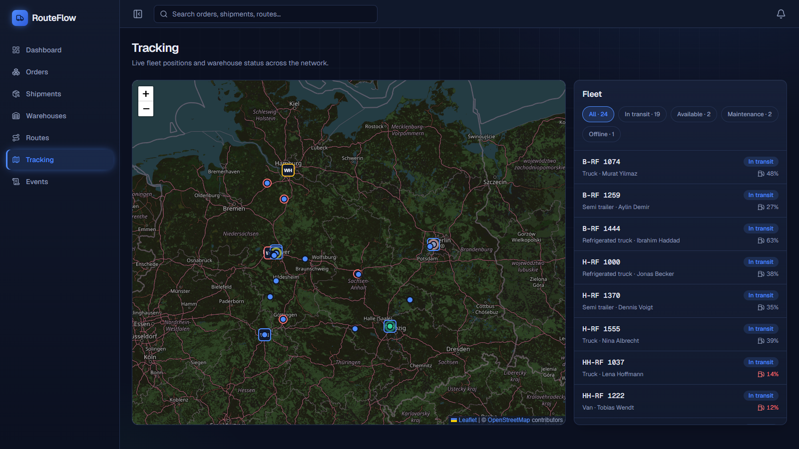
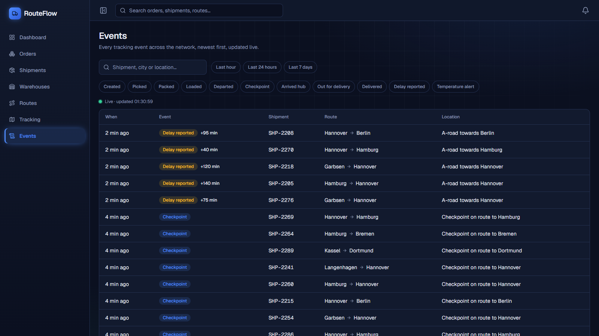
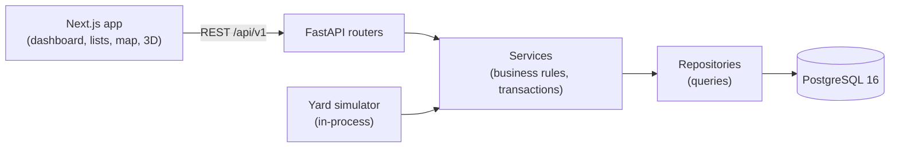

<div align="center">

# 🚚 RouteFlow

**A logistics operations platform: orders, shipments, routes, fleet, warehouses, and a live 3D digital twin of the warehouse yard.**

[](.github/workflows/ci.yml)


FastAPI + PostgreSQL backend · Next.js + React Three Fiber frontend · fully containerised



</div>

---

## ✨ Highlights

| | |
|---|---|
| 📊 **Control-room dashboard** | Live KPIs (active and delayed shipments, on-time delivery vs yesterday, open exceptions, warehouse and fleet utilisation), the logistics flow and live exceptions, with animated numbers. |
| 🌐 **3D network overview** | Every warehouse on one interactive board, sized and coloured by status and utilisation; click a site to fly into it. |
| 🏭 **3D warehouse yard** | An isometric digital twin: trucks drive in, reverse into dock doors and leave; forklifts carry pallets to the racks and give way to trucks and each other; pins mark pallets with stock problems. Dock schedule, day/night, search (`/`), shortcuts (`?`). |
| 🧭 **Explainable route risk** | Routes get a risk score *with its reasons* ("2 delayed shipments, worst delay 95 min") and a *highest risk first* ranking. |
| 📦 **Orders · Shipments · Events** | Sortable, filterable, paginated lists. Filters live in the URL, so any view can be shared; side panels show tracking history and open exceptions. |
| 🗺️ **Fleet map** | Vehicles and warehouses on a map, filterable by status and synced with the vehicle list. |

## 📸 Screenshots

<table>
  <tr>
    <td width="50%"><p align="center"><b>Orders</b></p></td>
    <td width="50%"><p align="center"><b>3D network overview</b></p></td>
  </tr>
  <tr>
    <td><p align="center"><b>3D yard — night</b></p></td>
    <td><p align="center"><b>3D yard — day</b></p></td>
  </tr>
  <tr>
    <td><p align="center"><b>Shipment details</b></p></td>
    <td><p align="center"><b>Highest-risk routes</b></p></td>
  </tr>
  <tr>
    <td><p align="center"><b>Fleet map</b></p></td>
    <td><p align="center"><b>Network event feed</b></p></td>
  </tr>
</table>

## 🚀 Quick start (Docker)

You need [Docker](https://docs.docker.com/get-docker/) with Compose. Nothing else.

```bash
git clone https://github.com/<your-user>/RouteFlow.git
cd RouteFlow
cp .env.example .env                  # then set POSTGRES_PASSWORD (any value)
docker compose up -d --build          # database + API + web app; migrations run automatically
docker compose run --rm -e RUN_MIGRATIONS=0 backend python -m app.seed   # demo data
```

| Service | URL |
|---|---|
| Web app | http://localhost:3000 |
| API docs (Swagger) | http://localhost:8000/docs |

Stop with `docker compose down` (add `-v` to also delete the database). Re-create the demo data
with the seed command plus `--reset`. If port 5432, 8000 or 3000 is taken, change
`POSTGRES_PORT`, `BACKEND_PORT` or `FRONTEND_PORT` in `.env`.

> [!NOTE]
> The 3D yard is populated by a small deterministic **yard simulator** that keeps a rolling
> schedule of truck visits. Turn it off with `YARD_SIMULATION_ENABLED=false` once you feed real
> dock appointments.

## 🧱 Tech stack

| Layer | Choice |
|---|---|
| Backend | Python 3.12, FastAPI, Pydantic v2, SQLAlchemy 2 (async, asyncpg), Alembic |
| Database | PostgreSQL 16 |
| Frontend | Next.js 15 (App Router), React 19, TypeScript (strict), Tailwind CSS 4, TanStack Query, anime.js |
| Maps / 3D | Leaflet (fleet map), three.js + React Three Fiber + drei (network board, yard) |
| Quality | pytest, ruff, strict mypy, Vitest, Testing Library, ESLint, Prettier, pre-commit |
| Dev / ship | Docker, Docker Compose (multi-stage, non-root images, health checks), GitHub Actions |

## 🏗️ Architecture



- **Modular monolith.** Each domain (orders, warehouses, inventory, shipments, tracking, exceptions, routes, fleet, yard, dashboard) has its own models, schemas, pure business rules, repository, service and thin router. Business rules are plain functions with unit tests; SQL and Python versions of the same rule are checked to agree.
- **State is derived, not stored.** A truck visit stores only its planned timestamps; "en route / waiting / docked / loading / departed" is computed from the clock. The 3D view animates from the same timestamps.
- **Honest data layer.** UUID keys with human-readable numbers (`ORD-…`, `SHP-…`), CHECK constraints for every enum, race conditions reproduced and fixed with two real concurrent transactions.
- **Frontend renders, backend decides.** The UI never re-implements business rules; risk scores, delays and statuses come from the API.
- **Accessible.** Keyboard-reachable tables and panels, `aria-sort`, `aria-expanded`, colour is never the only signal, reduced motion is respected.

Design notes: [ARCHITECTURE.md](ARCHITECTURE.md) · working notes and decisions: [CONTEXT.md](CONTEXT.md).

<details>
<summary><b>Project layout</b></summary>

```
RouteFlow/
├── backend/
│   ├── app/
│   │   ├── core/            config, database, logging, error envelope, clock
│   │   ├── api/             /api/v1 router, shared dependencies
│   │   ├── modules/<domain> models · schemas · rules · repository · service · router
│   │   └── seed/            deterministic demo data
│   ├── alembic/             migrations (also used to build the test database)
│   └── tests/               unit · service · api · db
├── frontend/
│   ├── src/app/             Next.js routes
│   ├── src/features/        dashboard, ops lists, tracking map, network3d, site3d
│   └── tests/               Vitest + Testing Library
├── docker-compose.yml
└── .github/workflows/ci.yml
```

</details>

## 🛠️ Development without Docker

```bash
# backend (needs uv: https://docs.astral.sh/uv/)
docker compose up -d postgres
cd backend
uv sync
uv run alembic upgrade head && uv run python -m app.seed
uv run uvicorn app.main:app --reload          # http://localhost:8000/docs

# frontend (Node 20.17+ or 22)
cd frontend
npm install
npm run dev                                   # http://localhost:3000
```

## ✅ Tests and quality

```bash
cd backend
uv run pytest --cov                    # 433 tests against real PostgreSQL, 100 % line + branch coverage
uv run pytest -m "not integration"     # fast tests without a database
uv run ruff check . && uv run ruff format --check . && uv run mypy app tests
uv run alembic check                   # migrations match the models

cd frontend
npm test                               # 122 tests (Vitest + Testing Library)
npm run lint && npm run typecheck && npm run build
```

| Layer | What it proves |
|---|---|
| Unit | Business rules (status transitions, risk score, yard visit states, forklift traffic) without a database |
| Service / API | Use cases and HTTP behaviour against real PostgreSQL: filters, sorting, pagination, the error envelope, validation on every endpoint |
| Database | Constraints, migrations equal models, seed data, concurrency (real concurrent transactions) |
| Frontend | Components, URL-backed filters, accessibility roles, 3D logic (layouts, paths, collisions, dock schedule) as plain functions |

The test database is rebuilt from the real Alembic migrations on every run, warnings are errors,
test order is randomised, and CI runs every gate above plus a Docker build on each push.

## 🔌 API at a glance

Interactive docs at `/docs`. Main resources:

| Resource | Endpoints |
|---|---|
| Orders | `GET/POST /api/v1/orders`, `GET/PATCH/DELETE /api/v1/orders/{id}`, `GET …/by-number/{number}` |
| Shipments | `GET /api/v1/shipments` (status, delayed, exceptions, search, ETA range), `GET …/{id}`, `GET …/{id}/tracking`, `POST …/{id}/events`, `POST …/{id}/exceptions` |
| Events | `GET /api/v1/events` — network-wide feed (type, search, since) |
| Exceptions | `GET /api/v1/exceptions`, `PATCH …/{id}` (investigate / resolve) |
| Routes | `GET /api/v1/routes`, `GET /api/v1/routes/at-risk` (ranked, explainable), `GET …/{id}` |
| Fleet | `GET /api/v1/vehicles`, `/drivers`, `/fleet/overview` |
| Warehouses | `GET /api/v1/warehouses`, `…/{id}/inventory`, `…/{id}/docks`, `…/{id}/equipment`, `…/{id}/scene` (3D view payload) |
| Dashboard | `GET /api/v1/dashboard/overview` |
| Health | `GET /api/v1/health`, `GET /api/v1/health/ready` |

## 🗺️ Roadmap

- [x] Backend: orders, warehouses, inventory, shipments, tracking, exceptions, routes, fleet, dashboard
- [x] Quality tooling, CI, Docker (backend + frontend)
- [x] Frontend: dashboard, orders, shipments, routes, events, fleet map
- [x] 3D warehouse digital twin, yard simulator, 3D network overview, dock schedule
- [ ] Write actions in the UI (record events, resolve exceptions, create orders)
- [ ] Authentication and roles
- [ ] End-to-end tests, generated API client, production hardening

## 🙏 Credits and license

The 3D yard view was inspired by the "WareTrack" warehouse demo shared by Stanislav Beliaev;
all code, models and branding in this repository are original. Map data © OpenStreetMap contributors.

Released under the [MIT License](LICENSE).
